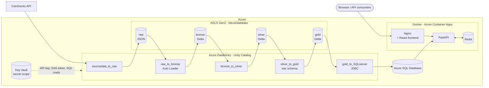
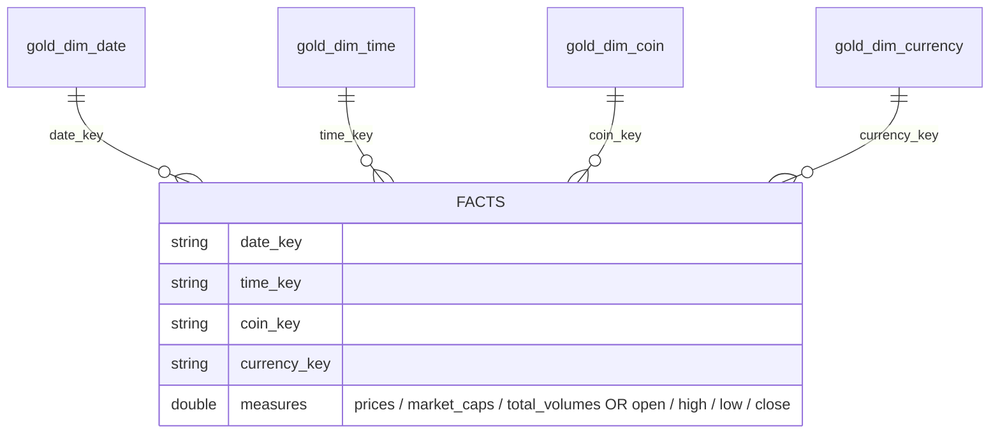

# ₿ Bitcoin Data Platform — Azure Databricks Lakehouse + FastAPI + React

An end-to-end data platform that ingests Bitcoin market data from the **CoinGecko API**, refines it through a
**Medallion lakehouse** (raw → bronze → silver → gold) on **Azure Databricks + ADLS Gen2**, models it as a
**star schema**, publishes it to **Azure SQL Database**, serves it through a **rate-limited, Redis-cached
REST API** built with **FastAPI**, and shows it in a **React dashboard**.

```
CoinGecko API ──► Databricks (PySpark / Spark SQL / Delta Lake) ──► Azure SQL Database ──► FastAPI + Redis ──► React dashboard / API clients
```

## Why this project exists

This is a **personal project**. It isn't school coursework, a tutorial follow-along, or work done for an employer.
I designed and built it on my own, with my own Azure subscription, to get hands-on with the full lifecycle
of a modern data platform rather than just one piece of it:

- **Provisioning cloud infrastructure:** Databricks, ADLS Gen2, Key Vault, Azure SQL and Container Apps
- **Building incremental, idempotent pipelines:** Medallion architecture with Auto Loader and Delta `MERGE`
- **Modelling data for consumers:** a Kimball star schema
- **Serving data as a product:** a secured, rate-limited, cached REST API that other applications can use

Bitcoin market data was a good fit because it's free to access, updates continuously, and has a natural time-series
structure. That makes problems like incremental loads, time-grain alignment and deduplication real ones I had to solve.

| Component | Folder | What it does |
|---|---|---|
| **Data pipeline** | [`pipeline/`](pipeline/) | 5 Databricks notebooks: ingestion, Auto Loader, cleaning, dimensional modelling, export |
| **REST API** | [`api/`](api/) | FastAPI service exposing the gold layer, with API keys, rate limiting and caching |
| **Frontend** | [`frontend/`](frontend/) | React dashboard: price and candlestick charts, API key management and an API explorer |

---

## Architecture



---

## Tech stack

| Area | Technologies |
|---|---|
| Cloud | Azure Databricks, ADLS Gen2, Azure Key Vault, Azure SQL Database, Azure Container Apps |
| Processing | PySpark, Spark SQL, Delta Lake, Databricks Auto Loader (`cloudFiles`), Unity Catalog |
| Modelling | Medallion architecture, Kimball star schema (facts + conformed dimensions) |
| API | Python 3.13, FastAPI, SQLModel / SQLAlchemy, pyodbc (ODBC Driver 18), Pydantic |
| Frontend | React 19, TypeScript, Vite, TanStack Query, Lightweight Charts, Tailwind CSS, Vitest |
| Caching & limits | Redis (response cache, auth cache, per-key usage counters) |
| Packaging | Docker, Docker Compose, Nginx reverse proxy, uv |

---

## 1. Data pipeline (`pipeline/`)

Every notebook takes a `mode` parameter, so the same code handles both kinds of run:

- **`initial_load`** loads the history once: 90 days of hourly prices, 30 days of 4-hour OHLC candles, and all dimension tables.
- **`incremental_load`** runs daily and loads the previous day: 5-minute prices and 30-minute OHLC candles.

| # | Notebook | Layer | Key techniques |
|---|---|---|---|
| 1 | `sourcedata_to_raw.ipynb` | API → **raw** | Calls the CoinGecko `market_chart/range`, `ohlc` and `coins` endpoints. Writes JSON to ADLS, under `history/` or a `YYYY-MM-DD/` partition. Credentials come from a Key Vault-backed secret scope |
| 2 | `raw_to_bronze.ipynb` | raw → **bronze** | **Auto Loader** (`cloudFiles`) with explicit schemas and schema location, `trigger(availableNow=True)`. Checkpoints make the ingestion exactly-once and incremental, then it appends to Delta |
| 3 | `bronze_to_silver.ipynb` | bronze → **silver** | Parses nested `ARRAY<ARRAY<DOUBLE>>` payloads (`from_json`, `arrays_zip`, `explode`) and converts epoch milliseconds to timestamps. **Idempotent `MERGE`** for history, `INSERT OVERWRITE` of yesterday's rows for live data |
| 4 | `silver_to_gold.ipynb` | silver → **gold** | Builds the star schema. Aligns timestamps to a fixed interval grid, rolls each day's fine-grained data into the history fact tables, and deduplicates with `ROW_NUMBER()`. The date dimension comes from the facts, and the time dimension is generated (288 five-minute slots, with trading-session and interval flags) |
| 5 | `gold_to_SQLserver.ipynb` | gold → **Azure SQL** | Finds every `gold_*` table in the catalog and publishes it to Azure SQL Database over JDBC |

### Gold data model (star schema)



| Fact table | Grain | Window |
|---|---|---|
| `gold_fact_hourlyprices_last90days` | 1 hour: price, market cap, volume | rolling 90 days |
| `gold_fact_4hourlyohlc_last30days` | 4 hours: OHLC candles | rolling 30 days |
| `gold_fact_5minprices_lastday` | 5 minutes: price, market cap, volume | previous day |
| `gold_fact_30minohlc_lastday` | 30 minutes: OHLC candles | previous day |

The dimension tables are `gold_dim_date`, `gold_dim_time`, `gold_dim_coin` and `gold_dim_currency`. The model is built so
more coins and currencies can be added later without changing the fact tables.

---

## 2. REST API (`api/`)

A FastAPI service that reads the gold star schema from Azure SQL Database and returns the joined data as JSON.

**Features**
- **API key authentication.** Keys are generated with `uuid4` and stored as **salted SHA-256 hashes**, never in plain text.
- **Rate limiting.** Each key gets 100 requests per day, counted atomically in Redis (`INCR` + TTL).
- **Redis caching.** Query results and authenticated keys are cached for 5 minutes, so repeated requests skip the database.
- **Write-behind sync.** A background task runs every 15 minutes and copies usage counters from Redis to SQL, so the API never writes to the database on the request path. Another task resets the counters every day.
- **Layered design.** Routers, a `DataManager` facade, per-domain services, SQLModel models and Pydantic schemas are kept separate, with dependencies injected for the DB session and Redis.
- **Containerised.** Docker Compose runs Nginx, the app and Redis together. Nginx also serves the frontend. The same three containers run on Azure Container Apps.

### Endpoints

| Method | Path | Query params | Returns |
|---|---|---|---|
| `PUT` | `/generareApi/` | body: `{ "key_name": str, "owner_email": str? }` | `{ key_name, api_key }` (the key is shown only once) |
| `GET` | `/get_historyChart` | `key_name`, `api_key`, `start_date`, `end_date`, `limit` | Hourly price, market cap and volume (90 days) |
| `GET` | `/get_liveChart` | `key_name`, `api_key`, `start_time`, `end_time`, `limit` | 5-minute price, market cap and volume (previous day) |
| `GET` | `/get_historyOhlc` | `key_name`, `api_key`, `start_date`, `end_date`, `limit` | 4-hour OHLC candles (30 days) |
| `GET` | `/get_liveOhlc` | `key_name`, `api_key`, `start_time`, `end_time`, `limit` | 30-minute OHLC candles (previous day) |

Interactive docs are served at `/docs` (Swagger UI).

```bash
# 1. Create a key
curl -X PUT http://localhost/generareApi/ \
     -H "Content-Type: application/json" \
     -d '{"key_name": "demo", "owner_email": "me@example.com"}'

# 2. Query the gold layer
curl "http://localhost/get_historyOhlc?key_name=demo&api_key=<KEY>&start_date=2026-01-01&limit=5"
```

```json
[
  {
    "timestamp": "2026-01-01 00:00:00",
    "coin_name": "bitcoin",
    "currency_name": "USD",
    "open": 93512.4, "high": 94100.8, "low": 93220.1, "close": 93987.6
  }
]
```

<sub>The values above are illustrative.</sub>

Error codes: `404` means the key name or API key is invalid, `429` means the daily limit has been reached, and `401` means the key name is already taken.

---

## 3. Frontend (`frontend/`)

A React single-page app that uses all five API endpoints. Nginx serves it at `/` and forwards its calls to
FastAPI under `/api/`, so the browser talks to one origin and the API needs no CORS setup. The API's original
paths (`/get_historyChart`, `/docs`, ...) still work.

| Page | Endpoint(s) | What it shows |
|---|---|---|
| **Overview** | all four `GET` endpoints | Latest price, 24h change and range, market cap, volume, price chart, recent candles, previous-day summary |
| **Price history** | `GET /get_historyChart` | Hourly price, market cap or volume with a date filter, sortable table and CSV export |
| **Previous day** | `GET /get_liveChart` | Intraday chart for the last loaded day, with a time filter |
| **Candles** | `GET /get_historyOhlc`, `GET /get_liveOhlc` | Candlestick charts: 4-hour for 30 days, 30-minute for the previous day |
| **API keys** | `PUT /generareApi/` | Create a key (shown once), or use an existing one. The key is saved in the browser |
| **API explorer** | all five | Send any request with your own parameters; see status, timing, JSON and the matching `curl` |

**Design notes**
- **Built around the rate limit.** Every data call counts against 100 requests a day, so the dashboards fetch each
  dataset once, keep it for 30 minutes and filter ranges in the browser. Normal browsing uses about four requests.
- **Honest usage counter.** The API has no usage endpoint, so the header shows the browser's own tally of requests
  made with the saved key.
- **Clear failure states** for an invalid key (`404`), the daily limit (`429`), a taken key name (`401`) and the
  database waking up from auto-pause.
- **Light and dark themes**, following the system setting with a manual switch. Works at phone width.

---

## Getting started

### Pipeline (Azure Databricks)
1. Provision an **ADLS Gen2** account with `raw`, `bronze`, `silver` and `gold` containers, an **Azure SQL Database**, and a **Key Vault**.
2. Create a Databricks secret scope called `Connectors`, backed by the Key Vault, with these keys: `api-key` (CoinGecko demo key), `SAS-token`, `username` and `sqlpassword`.
3. Import the notebooks from `pipeline/` and create a Databricks Job that runs them in order (1 → 5) with the job parameter `mode`.
   Run it once with `initial_load`, then schedule it daily with `incremental_load`.

### API (local, Docker)
```bash
cd api
cat > app/.env <<'EOF'
DATABASE_URL=mssql+pyodbc://<user>:<password>@<server>.database.windows.net:1433/<db>?driver=ODBC+Driver+18+for+SQL+Server
REDIS_HOST=redis
REDIS_PORT=6379
EOF
docker compose up --build
# → http://localhost/       dashboard
# → http://localhost/docs   Swagger UI
```

### Frontend (development)
`docker compose up` already builds and serves the frontend. To work on it with hot reload:
```bash
cd frontend
npm install
npm run dev        # http://localhost:5173, proxies /api to the containers on port 80
npm test           # unit tests
npm run build      # type-check and build to dist/
```

---

## Repository layout

```
.
├── pipeline/                    # Azure Databricks notebooks (Medallion ETL)
│   ├── sourcedata_to_raw.ipynb
│   ├── raw_to_bronze.ipynb
│   ├── bronze_to_silver.ipynb
│   ├── silver_to_gold.ipynb
│   └── gold_to_SQLserver.ipynb
├── api/                         # FastAPI service
│   ├── app/
│   │   ├── main.py              # routes + background schedulers
│   │   ├── core/                # settings, DB engine, Redis client
│   │   ├── crud/                # services: chart, ohlc, api keys, redis, DataManager
│   │   ├── db/                  # SQLModel tables mapped to the gold star schema
│   │   └── schemas/             # Pydantic response/request models
│   ├── nginx/                   # reverse proxy; its image also builds and serves the frontend
│   ├── Dockerfile
│   ├── docker-compose.yml
│   └── pyproject.toml / uv.lock
└── frontend/                    # React dashboard
    ├── src/
    │   ├── api/                 # typed API client + data hooks
    │   ├── charts/              # price and candlestick charts
    │   ├── components/          # layout, table, shared UI
    │   ├── pages/               # Overview, Price history, Previous day, Candles, API keys, API explorer
    │   ├── state/               # saved key + usage counter, theme
    │   └── lib/                 # formatting, statistics, CSV
    ├── vite.config.ts
    └── package.json
```

---

## Design decisions

- **Auto Loader with `availableNow`** gives streaming-style checkpointing (each file is processed exactly once) while running as a cheap scheduled batch job instead of an always-on cluster.
- **Two time grains per metric.** A coarse rolling history plus a fine-grained previous day matches what CoinGecko's free tier returns, and keeps the fact tables small.
- **Gold is published to Azure SQL** so the API can use a standard relational driver and connection pooling, without depending on a Databricks SQL warehouse being up.
- **Redis sits in front of everything the API does on each request**: auth, rate limiting and query results. SQL only gets cache misses and the batched usage sync.

## Roadmap

- [ ] Move the API key from the query string to an `X-API-Key` header
- [ ] Infrastructure as code (Bicep or Terraform) and CI/CD (GitHub Actions, Databricks Asset Bundles)
- [ ] Data-quality checks (expectations) between layers, plus unit tests for the API
- [ ] More coins and currencies (the dimensional model already supports them)
